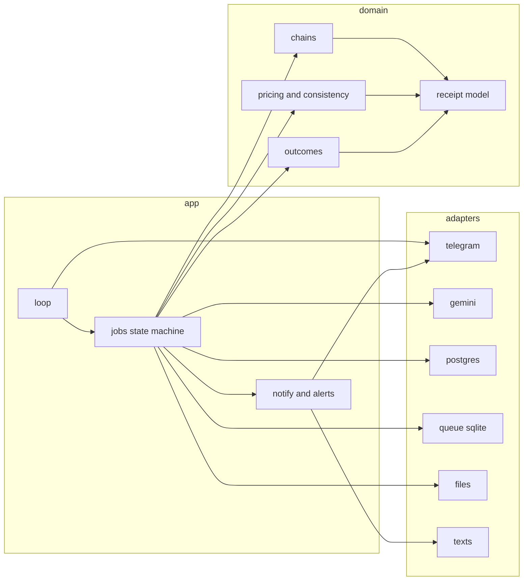
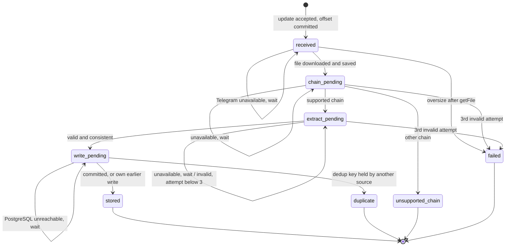
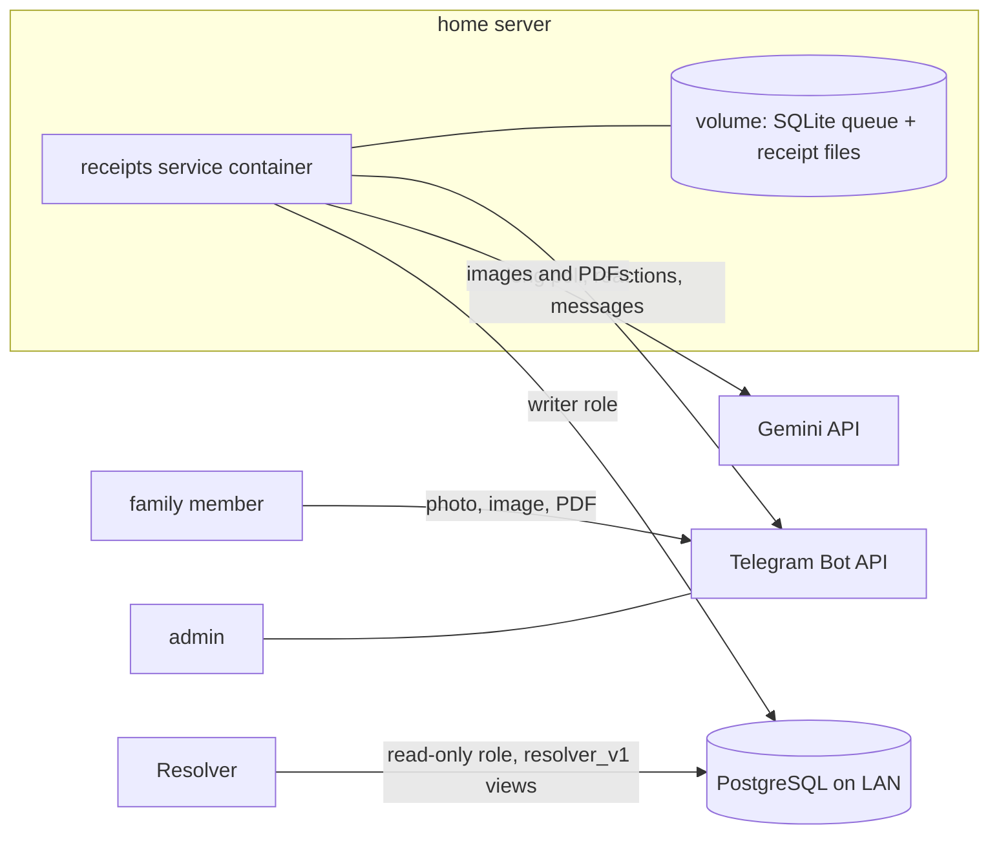
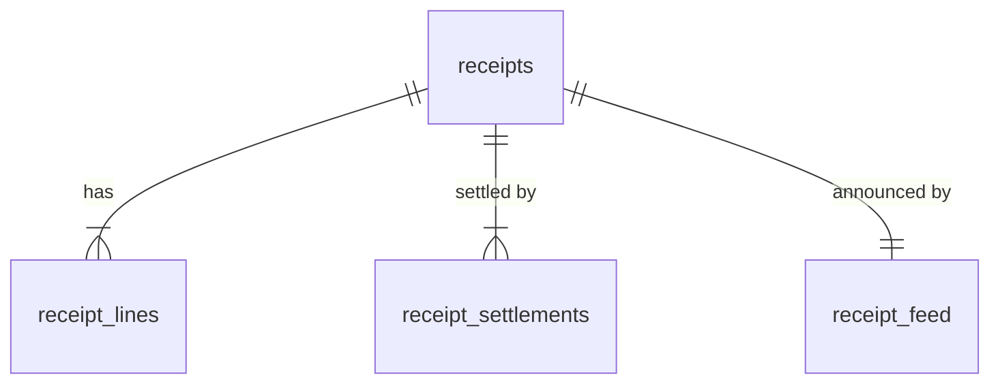

# Architecture Spine — receipts-import

## Design Paradigm

Hexagonal. A pure domain core holds the chain plug-ins, pricing, the consistency check and the outcome rules, and imports no I/O. Ports sit at every edge: Telegram, Gemini, PostgreSQL, the SQLite job queue, the local file store, the clock and the texts file. Each receipt is a durable **job** that moves through one state machine. One process runs a single synchronous loop: long-poll Telegram, persist new jobs, process due jobs one at a time, repeat.



Arrows are allowed imports. `domain` imports nothing outside `domain`. Adapters import only `domain` types. Only `app` wires adapters together.

## Invariants & Rules

### AD-1 — Waiting receipts live in a local SQLite queue `[ADOPTED]`

- **Binds:** CAP-1, CAP-9
- **Prevents:** units picking different durable stores for a waiting receipt, or holding it only in memory.
- **Rule:** Every accepted receipt is a job row in one SQLite file on the compose volume, together with its local file path. PostgreSQL never holds job state. Intake keeps accepting jobs while PostgreSQL is down.

### AD-2 — The Telegram offset is acknowledged only after the job is durable

- **Binds:** CAP-1, CAP-9
- **Prevents:** an acknowledged update with no durable job, which is a lost receipt.
- **Rule:** The next `getUpdates` offset is stored in the SQLite queue, in the same transaction that inserts the jobs for that batch of updates. No separate offset file. An update that is filtered out (gate or unsupported content) still advances the offset in that transaction. Intake makes no download. A job row holds only the source reference, Telegram `file_id`, kind and declared size. One accepted-type list in `domain` is shared by the gate and the preprocessing. Content outside it, a declared size over 20 MB, or an unconfirmed size gets the "not accepted" reaction and no job.

### AD-3 — One owner of job state

- **Binds:** CAP-1, CAP-6, CAP-8, CAP-9
- **Prevents:** two units writing job state, or a restart resuming at the wrong step.
- **Rule:** Only the jobs module changes a job's state, and each transition is one SQLite transaction. States: `received` → `chain_pending` → `extract_pending` → `write_pending` → one final state: `stored`, `duplicate`, `unsupported_chain` or `failed`. `received` is the download step. A Telegram outage there is a wait. A size over 20 MB after `getFile` fails the job, and the admin notice then carries no file copy. The local path is derived from the source reference. `write_pending` holds the normalized, consistency-checked receipt (AD-17) in the job row. While PostgreSQL is unreachable the job waits there, and Gemini is not called again. A job is resumed from its persisted state, never re-derived. Non-allowlisted senders, non-private chats and unsupported content never become jobs.



### AD-4 — Two-pass extraction `[ADOPTED]`

- **Binds:** CAP-2, CAP-9
- **Prevents:** chain detection mixed into extraction, or pass 1 re-run after a restart.
- **Rule:** Pass 1 asks Gemini only for the chain, with a small schema. Its result is persisted on the job. Pass 2 uses only that chain's prompt and schema. Every call is a stateless `client.models.generate_content` with a response schema; the Interactions API is not used. The following come from config: the model id (default `gemini-3.8-flash`), temperature (left at the model default), `thinking_level` (lowest the model allows) and an explicit request timeout. `thinking_budget` and the SDK's `retry_options` are never set. The model version reported in each response is logged.

### AD-5 — The model transcribes; code computes

- **Binds:** CAP-2, CAP-3, CAP-4, CAP-5
- **Prevents:** pricing or trap handling split between the prompt and the code.
- **Rule:** Gemini returns printed values only: line texts, printed amounts, quantities, discount lines and settlement lines. Deterministic domain code per chain derives the regular and effective amounts and applies every chain trap: the Lidl footer `POPUST`, DM `STORNO RETKA`, Müller bonus points, Kaufland's ignored lines and its bank-terminal date. Line amounts are checked against the printed fields, never against price × quantity. A cash payment records the receipt total and ignores the change. The code then runs the ±0.01 EUR items-vs-settlement check. Fixtures test all of this without the network.

### AD-6 — A chain is one plug-in `[ADOPTED]`

- **Binds:** CAP-2, CAP-3
- **Prevents:** chain-specific branches scattered through the pipeline as the 5 chains grow to 10.
- **Rule:** Each supported chain is one unit under `domain/chains/<chain>/`: its pass-2 prompt, its response schema, its normalization rules and its fixtures. One registry lists them all, and that registry *is* the supported-chain list. The pass-1 vocabulary is the registry ids plus two sentinels defined in `domain`: `other` gives `unsupported_chain`, and `unreadable` is `invalid`. Pass 1 also returns the printed store name, for the admin message only. Chain ids are frozen once released, because they are part of the dedup key. Each plug-in fixes which printed field is the purchase time and has a fixture for paper and one for PDF where the chain issues both. A fixture of an unsupported chain must yield `other`. Adding a chain touches only its unit and one registry line. No code outside `domain/chains/` branches on a chain name.

### AD-7 — One classification of extraction results `[ADOPTED]`

- **Binds:** CAP-5, CAP-9
- **Prevents:** units classifying the same Gemini error differently.
- **Rule:** A single function maps every Gemini call result to one of four classes:
  - `unavailable`: HTTP 429, 5xx, an httpx timeout or transport error. No attempt is consumed. The job waits with no deadline, and the sender gets the in-progress reaction once, on the first `unavailable`. The next try is at `RetryInfo.retryDelay` from the error details, else `Retry-After`, else capped exponential backoff.
  - `blocked`: a configuration fault, classified from the SDK error status and reason, not the HTTP code alone. Examples: auth or billing failure, disabled quota, a retired model, a request rejected for its configuration. The job waits as for `unavailable`, consumes no attempt, and raises the `gemini_config` alert (AD-13).
  - `invalid`: a response that fails the schema or comes back empty or blocked for its content, a 4xx caused by this file, an `unreadable` chain or purchase date, or a consistency mismatch beyond ±0.01 EUR. One attempt is consumed, and the job re-runs the pass that produced it.
  - `valid`.

  The attempt limit is 3 per job, shared across both passes. After the 3rd `invalid`, the job goes to `failed` with the reason of the last attempt.

### AD-8 — Dedup is a database constraint

- **Binds:** CAP-6
- **Prevents:** units implementing "already stored?" differently, or racing on it.
- **Rule:** The dedup key is (chain, purchase timestamp to the second). The printed Europe/Zagreb wall time is converted to `timestamptz` in one shared function. A PostgreSQL unique constraint enforces the key. The receipt number and file hashes are never part of it. A unique violation maps to `duplicate`, except under AD-9.

### AD-9 — A job recognizes its own earlier write

- **Binds:** CAP-6, CAP-9
- **Prevents:** a sender seeing the duplicate reaction on their own first send after a crash between the PostgreSQL commit and the SQLite final mark.
- **Rule:** Each receipt row stores its source reference (Telegram chat id + message id), with a unique constraint. Before inserting, the writer looks up the source reference. If a row has it, the job resolves to `stored` and nothing is written. Otherwise a dedup conflict resolves to `duplicate`.

### AD-10 — One atomic PostgreSQL write per receipt

- **Binds:** CAP-4, CAP-7, CAP-11
- **Prevents:** partial receipts, and stored receipts the Resolver never hears about.
- **Rule:** The receipt, its lines, its settlement entries and its feed row are inserted in one PostgreSQL transaction. Nothing else writes to the receipt tables.

### AD-11 — Order of effects per job

- **Binds:** CAP-7, CAP-8
- **Prevents:** a notification sent before the durable write, a failed send undoing an outcome, or a file deleted before the admin copy.
- **Rule:** The order is:
  1. PostgreSQL commit.
  2. SQLite final state.
  3. Best-effort Telegram reactions, messages and the admin file copy, each with Telegram's retry rules (429 `retry_after`, at most 5 attempts), then only logged.
  4. Local file deletion.

  A notification is not retried after a crash. A failed send never changes the job state. At startup, a sweep deletes the local files of jobs already in a final state.

### AD-12 — The Resolver reads a feed, not tables `[ADOPTED]`

- **Binds:** CAP-11
- **Prevents:** the Resolver depending on internal tables, or losing events while it is down.
- **Rule:** The contract is a set of versioned read-only views in a dedicated `resolver_v<major>` schema. They expose the feed (a bigint `seq` cursor, increasing in commit order of this single writer, plus `receipt_id`) and the stored receipt data. The Resolver has its own role with `SELECT` on that schema only, and keeps its own cursor. `LISTEN/NOTIFY` may be added as a wake-up hint, never as the delivery. A breaking change creates a new major schema next to the old one. The contract lives in `docs/contracts/` and its version in `docs/api-versions.md`.

### AD-13 — Operational alerts on state change `[ADOPTED]`

- **Binds:** CAP-10
- **Prevents:** alert spam and Telegram 429s during a long outage.
- **Rule:** The service alerts the admin once when an error kind starts, with the reason. The kinds form a closed set: `postgres_unreachable`, `gemini_config`, `telegram_unreachable` and `internal:<state>`. A failed alert send is only logged and never raises a new alert. It alerts once more when that kind recovers. Alert state is kept in memory, so a restart may re-alert once. Receipt outcomes are not alerts; they follow the outcome matrix.

### AD-14 — One loop, one thread `[ADOPTED]`

- **Binds:** all
- **Prevents:** concurrency races on jobs, dedup and the offset.
- **Rule:** One process runs a synchronous loop: `getUpdates` (long poll) → persist jobs → process every due job sequentially → repeat. No worker pool, no asyncio, no second process writing the queue. While jobs are waiting, the long-poll timeout is shortened so that the next due job is not late.

### AD-15 — Telegram transport is the vendored reference pack `[ADOPTED]`

- **Binds:** CAP-1, CAP-8, CAP-10
- **Prevents:** a second Telegram client, or loss of the pack's token-redaction and retry guarantees.
- **Rule:** The tested `telegram_core` code from `doc-inbox/` is copied into `adapters/telegram/` and owned here, by owner decision; it is not a dependency. Keep its guarantees: no `raise_for_status`, token redaction, the poll read timeout, the 20 MB checks before and after `getFile`, and its gate and attachment precedence. Change it in three ways: the offset goes to the SQLite queue (AD-2), add `sendMessage` and `sendDocument`, and set reactions per the outcome matrix. All Telegram calls go through this one client. The reference pack's 🤔 reaction is not used; the outcome matrix owns every reaction.

### AD-16 — Per-job error boundary

- **Binds:** CAP-9, CAP-10
- **Prevents:** one bad job crash-looping the service and stopping intake until Telegram drops updates.
- **Rule:** The loop catches every exception of a job step at the job boundary.
  - Gemini results go through AD-7.
  - PostgreSQL connection-class errors (SQLSTATE class `08`, `57P01`–`57P03`) are a wait with backoff and raise `postgres_unreachable`.
  - Any other error keeps the job in its state with backoff. It consumes no attempt, tells the sender nothing, and raises `internal:<state>`.

  Each step start is counted on the job. A step started 3 times with no recorded result is treated as `internal`, which catches crashes the boundary cannot see. The loop always moves on to the next job and the next poll.

### AD-17 — One normalized receipt shape

- **Binds:** CAP-2, CAP-3, CAP-4, CAP-6, CAP-7
- **Prevents:** chain plug-ins, the job row and the writer each shaping the receipt differently, which can shift the dedup timestamp or turn money into floats.
- **Rule:** One pydantic `NormalizedReceipt` in `domain` is the only output of every chain plug-in and the only input of the writer.
  - The purchase time is converted from Europe/Zagreb to aware UTC exactly once, in `domain`.
  - Money is `Decimal`, serialized as decimal strings, including in the Gemini response schemas.
  - The job row stores it only through `model_dump_json`/`model_validate_json`, and it carries a `payload_version`. A version mismatch on resume sends the job back to `extract_pending` without consuming an attempt.
  - `receipt_id` is assigned when the job enters `write_pending`.

  This model is built before any chain plug-in.

## Consistency Conventions

| Concern | Convention |
| --- | --- |
| Naming | Self-explanatory English `snake_case` for tables and columns. A table names its entity in the plural (`receipts`, `receipt_lines`, `receipt_settlements`). Chain ids are lowercase ASCII slugs (`kaufland`, `lidl`, `dm`, `mueller`, `spar`). |
| IDs | `receipt_id` is a UUIDv7 from Python's `uuid.uuid7()` and is the id in the contract. Child rows are keyed by (`receipt_id`, `line_no`). The feed cursor is a bigint identity. |
| Money | `Decimal` in Python and `numeric(12,2)` in PostgreSQL, never float. The contract carries money as decimal strings. Settlement amounts are signed. Only EUR, so there is no currency column. |
| Time | Purchase time is stored as `timestamptz`, converted per AD-17. Contract timestamps are ISO-8601 UTC with an explicit `Z`. The contract also exposes the purchase local time with its Europe/Zagreb offset. All "now" values come from the clock port. |
| Timeouts | Every outbound call has an explicit timeout from config: Telegram (per the reference pack), the Gemini request timeout, and the PostgreSQL `connect_timeout` and `statement_timeout`. Nothing may block the loop indefinitely. |
| Outcome keys | Outcomes and failure reasons are closed enums in `domain`. The texts file is keyed by them. At startup the loader checks that every key is present and that every reaction emoji is one Telegram allows, and fails fast otherwise. |
| Environments | Dev and production use separate bot tokens, databases and volumes. Config refuses to start when the configured environment does not match the bot and database names it expects. |
| Errors | Adapters raise typed errors that the classifier (AD-7) or alerting (AD-13) maps. The domain never catches I/O errors. Never log or raise a secret: redact the bot token and API keys, and print DB DSNs without the password. |
| Config | Environment variables are validated at startup by one pydantic-settings model, which fails fast. User- and admin-facing texts and reaction emoji live in one TOML texts file outside `src/`, looked up by outcome key. |
| Logging | Stdlib `logging`, one line per job transition with job id and state. No receipt contents above DEBUG. |
| Untrusted input | Model output and receipt text are data. They are validated by schema and never executed or used as instructions. Incoming images are EXIF-transposed and, when over the pixel cap, downscaled to it before upload. |
| Tests | Unmarked tests use fakes for every port and never touch the network or a live database. Gemini responses are recorded once into `tests/fixtures/`, including a 429 and a timeout. PostgreSQL tests carry the `integration` marker and run in CI against a PostgreSQL service container, never against production. |

## Stack

| Name | Version |
| --- | --- |
| Python | 3.14 |
| uv | 0.13.4 |
| httpx | 0.28.1 |
| pydantic | 2.14.1 |
| pydantic-settings | 2.16.1 |
| psycopg (3, binary) | 3.3.6 |
| google-genai | 2.32.0 |
| Pillow | 13.0.0 |
| SQLite | stdlib `sqlite3` |
| Gemini model | `gemini-3.8-flash` (config) |
| ruff | 0.17.1 |
| mypy | 2.4.0 |
| pytest | 9.1.1 |
| Container base | `python:3.14.8-slim-trixie` |

## Structural Seed

```text
src/retail_receipts_import/
  domain/            # receipt model, pricing, consistency, outcome rules; no I/O
    chains/          # one package per chain + registry
  app/               # loop, jobs state machine, notify and alerts, wiring
  adapters/
    telegram/        # vendored telegram_core, adapted
    gemini/          # pass-1 and pass-2 calls, result classification input
    postgres/        # receipt writer, dedup handling
    queue/           # SQLite jobs and offset
    files/           # local receipt file store
  config.py          # pydantic-settings model
migrations/          # numbered plain SQL, applied by the migrate command
texts/messages.toml  # user and admin texts, reaction emoji
docs/contracts/      # resolver feed contract (semver)
```





Deployment: `git clone` with sparse-checkout and `compose build` on the home server. There is one compose service and one named volume. PostgreSQL is the existing LAN instance and is not in compose. Three PostgreSQL roles are used:

- the schema owner, used only by the `migrate` command;
- a writer login role, used by the service;
- a read-only Resolver role.

The writer gets the grants the addendum's trigger lesson lists. Migrations run on deploy with `compose run --rm <service> migrate`, and the owner credentials are passed only to that run. CI runs the standard check suite and the `integration` tests on every push.

## Capability → Architecture Map

| Capability / Area | Lives in | Governed by |
| --- | --- | --- |
| CAP-1 intake | `adapters/telegram`, `adapters/queue`, `app/loop` | AD-1, AD-2, AD-15 |
| CAP-2 extraction | `adapters/gemini`, `domain/chains` | AD-4, AD-5, AD-6, AD-17 |
| CAP-3 line pricing | `domain/chains`, `domain` pricing | AD-5, AD-6 |
| CAP-4 settlement | `domain` model, `adapters/postgres` | AD-5, AD-10 |
| CAP-5 consistency | `domain` consistency | AD-5, AD-7 |
| CAP-6 dedup | `adapters/postgres`, `app/jobs` | AD-8, AD-9 |
| CAP-7 atomic storage | `adapters/postgres` | AD-10, AD-11 |
| CAP-8 outcome feedback | `app/notify`, `domain` outcomes, texts file | AD-3, AD-11, Config convention |
| CAP-9 durable waiting | `app/jobs`, `adapters/queue` | AD-1, AD-3, AD-7, AD-14, AD-16 |
| CAP-10 operational alerts | `app/notify` | AD-13, AD-16 |
| CAP-11 Resolver handoff | `migrations/` (`resolver_v1`), `docs/contracts/` | AD-10, AD-12 |

## Deferred

- **PostgreSQL column-level model.** Decide in the storage story, within the naming and money conventions and mapped from `NormalizedReceipt` (AD-17). The ERD fixes only the entities.
- **Exact backoff cap and the poll timeout while jobs wait.** These are tuning values with no cross-unit effect. Set them in config.
- **Long-receipt image slicing.** Wait until a fixture shows Gemini failing on a tall receipt.
- **Contract field list for `resolver_v1`.** It is written with the CAP-11 story and released as 1.0.0. AD-12 fixes the shape.
- **Prompt wording per chain.** It is owned by each chain plug-in.
- **PostgreSQL server version.** Confirm it in the platform-baseline story. Nothing bound here depends on it.
- **Backups of the SQLite volume.** Not needed: the queue is transient, and each original stays in Telegram.
